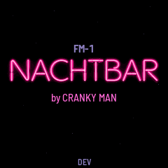
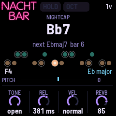
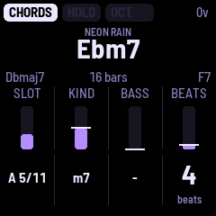

# FM-1 NACHTBAR for the M-VAVE FM-1

> **An early test build (nightly 0.9.99-nightly), not a release.** It is here to be tested: it has not been measured on
> a real FM-1 yet. How it sounds there, its CPU load and the screen's speed are what testers are asked to report.

A sampled tenor saxophone over a backing that plays itself. The sax is Cranky Man's own recording, eight notes a minor
third apart, each a recorded attack and a loop, played one note at a time and as hard as it is struck: keys held
together slur, a note let go fades out from its own loop. Under it the tune's chords play at its tempo: soft strings,
a high sampled piano playing short gestures, and a quiet drummer with brushes (seven patterns, or none). The sax snaps
to the tune's scale.

Sixteen tunes are the presets (PRESET picks one): charts (some with a second part), two endless walks and a drone, in
3, 4 and 6 beats a bar. Seven follow the chords of pieces by others (Neon Rain after Vangelis's Love Theme, and six
more, below); the other nine are plain progressions of their styles. Only their chords: the melody is yours. The song
plays from power-on; PLAY stops and starts it; REC holds a chord as long as you like (PLAY blinks), EDIT held moves on
to the next. Over minutes a slow arc swells and thins the backing (ARC), and a tune may drift up a fourth now and
then (DRIFT). EDIT tapped opens the Chords page: the tune's chords changed one at a time (the root from the keys,
the kind, a slash bass, the length in beats; added and removed, up to 32), kept with the rest of the tune in one of
eight user presets (SAVE). Played from a MIDI keyboard (the FM-1's TRS MIDI jack, or USB from a computer or a MIDI
host) or from the FM-1's keys. A body EQ and width for the sax, a delay timed to the tempo and a reverb follow. It
always starts on Neon Rain; nothing is saved but by SAVE.

NACHTBAR ("night bar") is a sibling of NACHTFAHRT; it was first called NIGHT SAX. Settings saved by an earlier
version (from before the user presets held their chords) are not read: it starts as new until SAVE.

## Test it

- **Try it in the browser first:** the emulator, <https://fartypants.github.io/fm1-nachtbar/nightly/emu/> (the same code the FM-1 runs, with sound and
  your MIDI keyboard).
- **Install it:** <https://fartypants.github.io/fm1-nachtbar/nightly/install/> (Chrome or Edge, the FM-1 connected by USB). Read "Before you install"
  below first.
- **The manual:** <https://fartypants.github.io/fm1-nachtbar/manual/>. The site: <https://fartypants.github.io/fm1-nachtbar/>

What to listen and look for:

1. Dropouts or crackle on busy tunes: DORIAN NIGHT with RHYTM on swing (the second Song page) and PIANO at 100 %
   (the Song page), for example.
2. The Setup page (GLO) after playing a while: the CPU PEAK and the LONGEST FRAME. Note them with the tune and its
   settings.
3. The keys' feel: how soft and hard notes come out, and keys held together slurring.
4. The Chords page (EDIT): change a tune's chords, keep them in a user preset with SAVE, load it again with PRESET.

**Report** at <https://github.com/FartyPants/fm1-nachtbar/issues>: the tune, the settings, the figures and what you heard or saw.

**Before you install.** Installing it replaces the firmware now on the FM-1. SAVE in the FM-1 NACHTBAR writes the place in the flash where other FM-1 firmwares keep their saved settings: theirs may be lost. To go back, install the other firmware again from its own installer; for M-VAVE's own, use the installer's "Back to the stock firmware", or M-VAVE's
updater, M-UPGRADE, from <https://www.m-vave.com/download>. Installing other firmware is at your own risk.

## Source

The source is GPL-3.0-only and will be published in this repository with version 1.0; until then it is available on
request (open an issue at <https://github.com/FartyPants/fm1-nachtbar/issues>).

## Credits

Based on FM-1 TENOR SAX (FartyPants), itself based on the FM-1 Hybrid Piano and NACHTFAHRT (FartyPants). From
NACHTFAHRT: the strings, the endless walk (After Hours' and Nightcap's chords; Nightcap's jazz leaning is this
firmware's own), the idea of the slow arc (its Density drift), the idea of the Chords page (its chord editor; the
keys setting a chord's root), the delay time's glide (its echo's ease) and the piano voice. The piano is a sampled grand's high notes (the Kawai grand of VCSL, CC0, by way of Felucca and NACHTFAHRT),
read by NACHTFAHRT's port of [SEA](https://github.com/Daninet/sea-codec) (Dani Biró, MIT) as in M-VAVE's
[fm1_open](https://github.com/m-vave/fm1_open). The recordings are stored as [QOA](https://qoaformat.org/) (Dominic
Szablewski, MIT). The drummer's rim click, brush stroke, ride cymbal and sticky snare are Cranky Man's own recordings; its brush tap
is synthesised, its noise section modelled on Skiff's DRUM-X (Leo Kuroshita, Hügelton Instruments, from JIANT FM by
juanjiant-bit). Neon Rain: after the chords of Love Theme (Vangelis, *Blade Runner*), charted by Cranky Man. All of
these are based on [DUB-1](https://github.com/sbegueria/fm1-dub) by sbegueria and
[AMB-1](https://github.com/charlesvestal/fm1-amb) by Charles Vestal; the platform is
[Felucca](https://github.com/hugelton/Felucca) by Leo Kuroshita (Hügelton Instruments). The keys' touch is
[fm1-monk](https://github.com/charlesvestal/fm1-monk)'s port of [Velo](https://github.com/charlesvestal/fm1-velocity)'s
sensing, both by Charles Vestal. The sampled-instrument approach follows [Erik37](https://github.com/genkigenki/erik37)
(no code from it). The saxophone recording is Cranky Man's own. GPL-3.0-only: see [LICENSING.md](LICENSING.md).

Six tunes play only the chords of pieces by others, read note by note from files Cranky Man supplied (the melodies are
the player's), under names of their own: First Light: after the chords of Songbird (Kenny G); Back Alley: after the
chords of Lily Was Here (David A. Stewart, featuring Candy Dulfer); Velvet Room: after the chords of Smooth Operator
(Sade); Old Flame: after the chords of Europa (Carlos Santana and Tom Coster; the file follows Gato Barbieri's
version); Candlelight: after the chords of Hymne (Vangelis); Unseen Man: after the chords of To the Unknown Man
(Vangelis; from a transcription of the recording). The FM-1 NACHTBAR is not connected with any of these artists.

M-VAVE and FM-1 are trademarks of their owners. The FM-1 NACHTBAR is not affiliated with M-VAVE or Hügelton Instruments.
